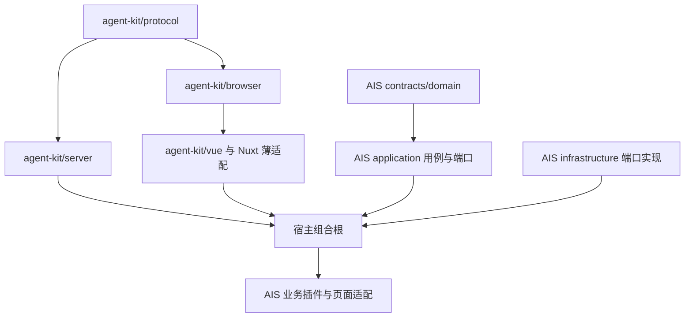

# 通用 Agent SDK 目标架构

本文记录已确认的目标设计，供后续开发实施。四个 `@agent-kit/*` 包、跨项目统一执行宿主、远程 MCP、全站业务操控和订单示例按后续路线实施。当前 AIS 应用已接入账号个人技能的发布、版本绑定和步骤恢复，详见[动态个人技能](agent-dynamic-skills.md)；当前代码能力见[现状架构](architecture.md)和[实施状态](implementation-status.md)。

开发顺序、责任写域与完成条件以[开发路线图](agent-sdk-roadmap.md)为准；AIS 当前 HTTP/UI 接口仍以[现行界面协议](agent-ui-protocol.md)、已有 Schema 和 OpenAPI 为准。

## 目标与宿主边界

SDK 提供任务执行、模型适配、技能和工具、调用账本、确认状态、浏览器协调及恢复能力。应用宿主负责身份认证、租户隔离、业务权限、业务工具、数据投影、领域结果和产品界面。服务端以 Node.js 24 ESM 运行，发布 JavaScript 与 `.d.ts`，通过私有 tarball 独立安装。

SDK 的会话、任务、事件、确认和 UI 协议采用 opaque string 身份。账号、租户、业务对象和资源版本的格式由宿主适配；AIS 保持既有 UUID、MMSI 和结果引用格式。通用协议禁止内置船型、海区、专题类型或 AIS 意图枚举。

浏览器 SDK 以状态和动作适配器连接业务组件。产品可使用任意布局、聊天面板和确认界面；SDK 提供 headless 状态与事件。HTTP 工具通过部署方登记的端点和契约调用任意语言后端，业务系统可采用 Java、C#、Python、Go 或其他技术栈。

## 四包与发布入口

| 发布包                | 目标入口与职责                                                                                        | 依赖约束                                                    |
| --------------------- | ----------------------------------------------------------------------------------------------------- | ----------------------------------------------------------- |
| `@agent-kit/protocol` | 通用会话、任务、调用、事件、结果引用、补充输入、审批与 UI 协议；类型、严格运行时 Schema、版本及错误码 | 浏览器和服务端均可加载；仅依赖明确声明的通用 Schema 库      |
| `@agent-kit/server`   | `/runtime`、`/pi`、`/skills`、`/mcp`、`/http`、`/testing`；执行循环、适配器、配置快照和测试替身       | 核心依赖 protocol；Pi/MCP/数据库等入口按需加载              |
| `@agent-kit/browser`  | 框架无关客户端、状态注册、心跳、命令队列、取消、领取、回执和导航过渡                                  | 依赖 protocol；浏览器入口保持 Node 内置模块与服务端凭据隔离 |
| `@agent-kit/vue`      | 生命周期 composables、响应式状态和注册辅助；`/nuxt` 提供薄适配                                        | 依赖 browser/protocol；Vue/Nuxt 依赖范围与入口分别声明      |

PostgreSQL 参考适配器采用 `@agent-kit/server/storage-postgres` 可选子入口，保持四个发布包。其驱动作为可选 peer dependency，由使用该入口的宿主安装。根入口和 `/runtime` 禁止导入 PostgreSQL、NATS、Nest 或 AIS 模块；打包测试验证未安装可选依赖时仍能加载核心与测试入口。

参考适配器交付独立表命名空间、版本化迁移和 transaction store，覆盖任务、租约、事件、结果、调用、审批与技能快照。宿主显式配置命名空间并执行迁移；模块导入和创建运行时不触发建表。transaction store 向各仓储提供同一事务上下文，落实预算/调用准备、审批消费/本地业务提交等原子操作；业务事务整合由宿主适配，跨库写入按既定恢复策略处理。`/testing` 的内存实现与 PostgreSQL 实现运行同一套端口契约测试，数据库实现追加并发、进程重启及迁移兼容测试。独立订单示例实际使用该参考适配器；AIS 使用既有表桥接，业务历史继续由原表读取。

`/pi` 保留 Pi agent-core/ai 的执行与模型能力；`/mcp` 计划采用 pi-mcp 1.1.0，远程协议兼容目标为 MCP 2025-11-25。MCP 连接和兼容性在实现阶段通过官方接口与互操作测试核实，当前仓库尚无该适配器。

四包分别声明 exports、类型入口、发布文件与依赖，采用统一兼容发布批次。首个稳定协议版本在契约任务中冻结；协商携带协议主版本和能力集合，未知必需字段或不兼容主版本返回结构化错误。新增可选能力通过协商启用，旧持久事件继续按保存的版本解码。AIS 旧协议由宿主映射，迁移期保持原接口响应与结果读取。

## 依赖与组合



图中箭头表达被依赖方到使用方。服务端核心、浏览器和 Vue 包均独立于 AIS。AIS 的目标 `packages/application` 依赖 contracts/domain 并声明最小仓储、授权、时钟与事务端口；infrastructure 通过 type-only 导入实现端口，apps 负责组合注入。application 禁止反向引用 infrastructure，service 禁止依赖 controller。

事务端口提供事务作用域内的业务仓储，应用用例保持数据校验、版本、审计和提交边界；具体 SQL 与 PoolClient 留在存储适配。跨 NATS、S3、ClickHouse 的处理使用现有 outbox、回执和幂等规则，数据库事务只承诺自身原子性。

AIS 先迁移 VesselQuery、ReplaySubmission、Intelligence，再按依赖推进 Topics、Acquisition、Identity 与 AgentConversation。共享 Actor/operation 授权和采集 fencing 修复前置。HTTP、WebSocket、Agent 工具调用同一应用用例，传输层保留请求校验、会话安全和响应映射。

## 服务端最小宿主端口

| 端口                             | 责任与契约要求                                                                             |
| -------------------------------- | ------------------------------------------------------------------------------------------ |
| Identity / Authorization         | 从可信会话或任务 owner 得到 actor/tenant；按 operation、资源和当前状态判权；执行前重查撤权 |
| TaskStore / LeaseStore           | 任务认领、输入修订、执行代次、租约、挂起和 CAS 续作；提交时再次 fencing                    |
| EventStore                       | 提交安全的事件序列、快照游标、增量读取和历史版本解码                                       |
| CallJournal / ApprovalStore      | 调用幂等、预算预留、确认绑定、执行状态、结果引用与对账                                     |
| ResultStore / ReferenceResolver  | 完整本地结果及不可变版本引用；每次解析校验权限、作用域与有效期                             |
| SkillCatalogStore                | 持久技能快照、catalogRevision CAS 发布、任务版本绑定及跨 worker 恢复                       |
| ToolRegistry / ProjectionPolicy  | 注册工具、schema、执行阶段、effect/risk、授权、输出与错误投影                              |
| ModelAdapter / Scheduler / Clock | 模型调用、调度唤醒、取消、固定时间与测试替身；等待阶段释放 worker                          |
| BusinessTransaction              | 宿主正式业务写入的事务适配；与审批消费/本地journal提交整合                                 |

端口结果使用通用协议或应用错误码。SDK核心通过内存测试适配独立验收；PostgreSQL适配作为参考实现，AIS以旧表适配接入。宿主保留唯一业务事实源，迁移阶段每类任务只有一个执行所有者。

## 公开接口草案

以下签名用于冻结宿主责任与调用方式，属于待实现API草案；接口名称与公开类型在PROTOCOL任务中连同示例确定。`Schema`表示具有运行时校验的通用schema接口，`HostPorts`、`ToolContext`、`TaskSnapshot`等结构由上文端口和protocol定义。

```typescript
type Schema<T> = { parse(value: unknown): T };
type Unsubscribe = () => void;
type CapabilityRequest = {
  capabilityId: string;
  arguments: Record<string, unknown>;
  skillId?: string;
};
type ToolDefinition<I, O> = {
  id: string;
  capabilityId: string;
  input: Schema<I>;
  output: Schema<O>;
  allowedPhases: readonly string[];
  effect: 'read' | 'ui' | 'write' | 'external';
  risk: 'low' | 'medium' | 'high';
  evaluateRisk(input: I, context: ToolContext, diff: ResourceDiff): Promise<RiskDecision>;
  resourceKeys(input: I): readonly string[];
  authorize(input: I, context: ToolContext): Promise<AuthorizationDecision>;
  execute(input: I, context: ToolContext): Promise<O>;
  project(output: O, context: ToolContext): Promise<unknown>;
  recovery: RecoveryPolicy;
};
interface AgentRuntime {
  registerTool<I, O>(tool: ToolDefinition<I, O>): void;
  submit(request: CapabilityRequest, context: TrustedSubmissionContext): Promise<TaskSnapshot>;
  decide(request: ApprovalDecision, context: TrustedSubmissionContext): Promise<TaskSnapshot>;
  resume(taskId: string): Promise<TaskSnapshot>;
  cancel(taskId: string, context: TrustedSubmissionContext): Promise<TaskSnapshot>;
  read(taskId: string, context: TrustedSubmissionContext): Promise<TaskSnapshot>;
  dispose(): Promise<void>;
}
declare function createAgentRuntime(options: {
  ports: HostPorts;
  model?: ModelAdapter | (() => Promise<ModelAdapter>);
  skills: SkillCatalog;
}): AgentRuntime;
declare function loadSkillCatalog(config: TrustedSkillConfig): Promise<SkillCatalog>;
interface SkillCatalog {
  snapshot(): CapabilityCatalogSnapshot;
  refresh(): Promise<CatalogRefreshResult>;
}
```

`TrustedSubmissionContext`由HTTP认证适配或受信后台入口建立，携带actor、tenant、请求幂等键及宿主授权上下文。工具执行身份、phase、预算和调用ID由runtime生成或从持久记录读取。`RecoveryPolicy`按只读重查、本地原子提交、远端幂等与查询对账等类别声明实现要求；注册时验证effect与恢复能力相符。

模型适配器接收宿主批准的消息与当前可执行工具，返回结构化调用和回复。`registerTool`由应用启动组合根调用；远端发现通过本地配置绑定后才进入同一注册表。`loadSkillCatalog`读取受信配置，`refresh`返回启用的新快照或保留旧快照的校验错误。

模型适配器可选并支持惰性工厂；仅在能力需要模型时初始化、读取密钥和预留模型预算。纯本地查询及本地 UI 任务在没有模型密钥时可以运行；需要模型而配置缺失时返回明确的能力配置错误。browser 的 clock/idFactory 由宿主注入，支持确定性超时与生命周期测试。

```typescript
interface CapabilityAdapter<S> {
  id: string;
  describe(): ComponentDescriptor;
  read(): S;
  subscribe(listener: (state: S) => void): Unsubscribe;
  execute(command: UiCommand, context: BrowserExecutionContext): Promise<UiReceipt>;
}
interface AgentBrowserClient {
  registerCapability<S>(adapter: CapabilityAdapter<S>): Unsubscribe;
  read(): BrowserStateSnapshot;
  subscribe(listener: (event: BrowserClientEvent) => void): Unsubscribe;
  execute(action: UserActionRequest): Promise<CommandHandle>;
  cancel(commandId: string): Promise<void>;
  transition(request: NavigationRequest): Promise<TransitionResult>;
  dispose(): Promise<void>;
}
declare function createAgentBrowser(options: {
  transport: BrowserTransport;
  identity: BrowserIdentityProvider;
  navigation: NavigationAdapter;
  clock: Clock;
  idFactory: IdFactory;
}): AgentBrowserClient;
```

browser的`execute`提交宿主登记的用户动作；模型命令通过服务端认领流程到达adapter，禁止页面直接伪造已获批准的命令。transport只处理协议请求，身份由宿主会话提供。`dispose`停止心跳与队列，取消本地等待并报告未决执行；已产生的远端副作用仍由journal对账。

Vue以`useAgentClient`、`useAgentCapability`、`useAgentSession`、`useAgentApprovals`等composables包装同一browser/runtime协议，返回状态和typed操作。组件自行选择聊天与审批布局；Nuxt薄适配在客户端安装唯一实例并连接路由生命周期。

## 工具目录、技能与模型循环

工具定义包含稳定 ID、输入/输出 schema、允许阶段、effect、risk、授权检查、业务 handler、模型投影及恢复策略。执行顺序为：解析可信执行身份和目录快照，检查工具与阶段，校验输入和权限，预留调用账本与预算，必要时等待确认，执行前复核版本与租约，调用 handler，校验输出，持久化结果和事件，再生成允许外发的投影。所有执行通道，包括本地查询、UI和区域研判，经过同一宿主治理。

任务按通用 `capabilityId + arguments` 绑定能力，领域意图解析由宿主提供。用户显式选择技能优先；自然语言匹配产生多个候选或缺少必要参数时持久化追问，确定后再执行。有效工具授权始终为“任务固定授权 ∩ 技能工具范围 ∩ 当前用户权限 ∩ 工具政策”，配置刷新和模型选择均不能扩大已绑定任务授权。

effect 区分只读、临时界面变化、业务写入与外部副作用；risk 由宿主工具配置和当前参数判定。技能文本只收窄代码或可信配置授予的工具范围，禁止自行提升权限、指定身份或注册任意执行代码。模型调用、技能激活、引用读取、工具调用分别计量，预算在任务重试与恢复中保持可追溯。

工具的静态 risk 定义最低风险级别，evaluateRisk 读取当前资源、字段 diff 和目标状态后决定最终风险与确认要求。情报 reviewStatus/withdrawn、专题 enabled 与配置重预热、source/job 状态和计划、账号权限变更分别建模；同一个 endpoint 中的普通字段编辑和业务状态转换使用各自策略。执行前重新计算并校验策略、资源版本及预览哈希，变化后重新确认。

技能从配置指定的可信目录加载，形成包含版本、正文、引用、工具绑定、adapter版本和schema摘要的不可变快照。刷新按显式管理操作或配置的检测周期进行：完整校验成功后原子切换新快照，失败保留旧快照并记录错误。新任务使用新快照；在途任务绑定原快照，撤销工具立即阻断新执行。旧快照缺失或无法安全恢复时进入 `skill_changed` 等可见状态，禁止无声换用新正文继续旧副作用。

管理员新增可信技能目录并执行 refresh 后，可立即组合已注册且已授权的工具，经通用 executor 输出结构化结果；这类扩展通过配置完成，无需修改 TypeScript 或业务 intent 枚举。技能 metadata 管理名称、描述、输入/结果 schema 和编排声明，可信授权配置独立管理可用工具及授权范围；新业务 handler、权限政策或专属展示组件仍通过各自实现流程接入。

SkillCatalogStore 持久化完整不可变 snapshot、内容 hash 与 catalogRevision。refresh 先完整校验并保存快照，再按预期 catalogRevision CAS 发布活动指针；并发刷新冲突返回可重试结果，失败保留原活动版本。所有 worker 按持久活动指针读取目录，任务提交原子绑定 revision/snapshot；进程重启和任务转移读取同一快照，执行前继续检查当前撤权。内存目录仅用于测试或单实例临时宿主，多 worker 与可恢复部署使用持久目录端口。

配置管理工具映射、目录和刷新策略，代码负责业务handler与安全边界。`SKILL.md`、引用文件、MCP工具描述、外部检索结果均按其信任来源处理；外部数据禁止改变系统指令或授权配置。

每次模型请求使用完整出站白名单校验，覆盖错误、续作、重试和历史压缩。AIS精确坐标、船舶标识、私有正文及凭据保留在本地；模型只获得宿主批准的描述、统计和受限引用。工具原始异常留在本地审计，模型与用户界面得到经过映射的错误。

## 调用账本、确认与未知结果

逻辑调用以持久 callId 标识，关联 actor/tenant、任务、输入修订、能力快照、工具版本、规范参数哈希、初始创建代次和当前执行代次。相同调用同参数返回已有状态；同调用不同参数返回幂等冲突。执行重试增加 attempt，保留逻辑调用身份。

TaskStore 与 CallJournal 的预算预留、调用唯一约束、身份/阶段检查和任务执行代次 CAS 在同一存储事务中完成。并发重试只形成一次逻辑调用和预算扣减，事务失败共同回滚；适配器需提供组合操作或共享事务作用域，禁止用彼此独立的成功返回模拟原子性。

调用状态覆盖 prepared、awaiting_approval、ready、executing、succeeded、failed、rejected、expired、cancelled、unknown。实际持久枚举在协议任务中冻结，状态转换应完整表达以下规则：

- 纯读取可按工具恢复策略重新读取，结果仍标明查询时间与版本。
- 本地业务写入由同一业务事务完成确认 approved→consumed、资源版本校验、业务提交、结果与成功账本；浏览器回执只证明界面变化。
- 外部副作用使用稳定幂等键及结果查询接口。请求发出后响应丢失进入 unknown，先查询远端或人工对账。
- unknown 禁止通过新callId、自动重试或worker代次迁移重做副作用；取得可验证结果后才继续依赖步骤。
- 批量调用按项记录结果及依赖，局部失败停止依赖该项的动作，并呈现已完成、失败与未执行项。

确认记录绑定 actor/tenant、callId/commandId、规范参数哈希、预览哈希、目标对象和人工草稿版本、策略版本、初始作用域及有效期。确认界面显示对象归属、修改差异、影响和恢复方式；缺少归属或目标时先补充输入。确认时与执行前再次鉴权，参数、预览、版本、权限或有效页面绑定变化使旧确认失效。

宿主按风险配置确认规则。查询、导航和可逆临时展示通常直接执行；普通编辑按已授权范围形成可核对的变更；删除、审核、权限变更、专题启停、启停采集、重放、来源/用户配置及草稿覆盖进入明确预览确认。所有业务按钮和Agent工具复用operation权限，批准不能替代访问权限。

确认 decision 事务只持久化决定和续作授权。等待阶段释放worker，运行超时只计执行段。每次挂起保存当前 pauseGeneration；decision以状态和代次CAS排队，claim事务消费一次性resume授权、推进执行代次，仅迁移尚未执行调用的fence。初始作用域保留审计含义，executing/unknown调用只进入对账。连续两轮确认分别使用新pauseGeneration，旧worker与旧resume持续失效。

AIS首期确认基线为pending五分钟、批准后30秒内领取、执行窗口30秒；引用默认30分钟并受权限和数据保留期的更早限制。通用SDK将这些期限作为有界策略配置，宿主冻结具体值。超时与等待、审批与补充输入分别建模；现有补充输入的有效期规则保持兼容。

## 框架无关浏览器运行时

browser维护一个实例生命周期内的注册、合并状态、独立心跳、命令发现/领取、按资源执行队列、取消和回执。同一目标资源串行执行，互不冲突资源在宿主规定的并发上限内运行；长操作、网络等待和导航不得阻塞心跳与取消。组件通过typed adapter暴露稳定能力ID、动作、mounted/opened/visible、availability、组件版本及人工交互锁。DOM选择器、任意JavaScript、任意URL和通用属性写入禁止作为工具接口。

浏览器是当前视野、选择、面板和草稿的状态权威；服务端保存带observedAt的镜像供规划与审计。数据刷新版本与操作冲突版本分离，高频AIS更新只推进dataVersion；人工拖动、选择和编辑推进受影响的componentVersion。产生副作用前再次读取实际状态并检查版本，人工操作优先。

客户端实例、pageGeneration、任务generation、inputRevision、resultVersion、资源版本分别校验。刷新生成新实例，旧页面命令不得被新实例接管；历史记录恢复只还原状态，主动再次展示产生绑定当前实例的新命令。领取后已开始执行但回执缺失时进入unknown。

导航使用单独的transition协议：按白名单routeId解析目标，预检草稿和权限，持久记录source绑定及transitionId，导航后由宿主确认目标路由就绪，再CAS建立target绑定/新pageGeneration。后续步骤等待transition终态并使用新绑定。旧页面上的普通命令仍失效；跨会话、重复导航、导航中断与刷新分别返回明确结果。需要丢弃草稿的导航遵循版本绑定确认。

目标组件挂载后的状态快照、新 binding 和导航成功回执在同一原子提交中完成。transition 进行期间，普通路由状态上报不能抢先推进 pageGeneration；服务端按 transitionId 和 source 绑定核对目标快照，失败时保留可诊断终态并使旧绑定命令失效。

协议支持账号作用域和会话作用域。账号动作由受信用户模板创建，允许无AI会话查看通知、定位和关闭；模型动作必须关联完整任务身份。browser提供状态和回调，vue负责响应式与卸载清理，`/nuxt`负责客户端安装和路由适配；宿主自定义聊天、审批和业务UI。

## AIS 临时展示与通知适配

AIS插件通过现有查询用例解析本地对象、时间与几何，形成绑定账号、会话/通知、任务及结果版本的DataReference。查询、展示、定位、绘制、保存按依赖分步执行。纯UI请求仅校验动作所需条件；混合任务在分析步骤缺少区域时补问，保留已经满足条件的界面步骤。

临时船位、轨迹、情报和点线面使用独立GeoJSON source/layer；用户TerraDraw草稿保留独立缓冲。详情读取、人工加入plot-set与临时显示分开。临时面板展开、布局重算和定位禁止隐式写入plot-set或localStorage偏好；人工动作仍通过明确入口保存。会话/页面切换、退出与实例失效清理临时资源和异步回包。空轨迹、缺失坐标和跨日期变更线分别按真实数据处理。

中央回复浮卡与右侧记录共享messageId，同一时刻显示当前一条，关闭只隐藏展示。待补充、待确认、运行、失败和完成均从持久任务/调用状态派生；“已显示”依据界面后置条件回执，“已保存”依据业务事务结果。

独立通知首期以已提交analysis_feed为AIS事件来源。按sourceType+resultId形成稳定eventId，revision沿用来源；首期severity固定info，后续严重等级须来自可信业务规则。首次账号订阅取提交安全高水位；通知写入与用户源游标同事务推进，展示游标独立。每次读取和定位重查权限，withdrawn作为新修订留档，历史补取标记replay并保持已关闭状态。

通知支持详情、定位、关闭与关联询问，后者才创建会话关联。info提醒默认10秒隐藏，warning/critical持续到关闭；悬停和键盘聚焦暂停计时，离开后继续。通知关闭、已读与业务结果分别保存，恢复历史仅更新列表。关注/点赞在接入真实业务服务、权限、结果和回执后注册。事件触发分析、长期监控与筹划比较由AIS产品后续业务任务推进。

## MCP 与 HTTP 工具适配

远程服务器、传输、工具映射、凭据引用和schema版本由宿主可信配置登记。首期采用HTTPS Streamable HTTP，以secretRef解析服务端bearer/header凭据；OAuth与stdio在对应身份/进程隔离方案完成后接入。按服务器与工具建立白名单，连接时验证服务身份及协议兼容，凭据只保留在服务端。工具发现结果作为待校验元数据，按本地effect/risk/权限策略绑定，禁止远端描述自行降低确认要求。

Pi/pi-mcp 1.1.0以MCP 2025-11-25为首期协议基线；较早协议版本按适配器实际支持与显式协商矩阵逐项验收。仅支持2026版新能力的服务不属于该版本兼容范围，须升级适配器并补互操作验证后启用。库版本与协议日期分别记录，不能从包版本推断所有远端均兼容。

MCP读工具先通过连接、schema漂移、超时、取消、输出上限、模型投影和跨租户测试，再开放写工具。写工具必须提供稳定幂等键、结果查询/对账、审批绑定与未知状态处理；能力不满足时保持只读接入。网络取消只表示本地停止等待，远端副作用结果仍以journal对账确认。

HTTP工具采用同样的注册、超时、schema、授权、预算和journal语义。远端业务后端校验服务身份与用户委托，宿主重新鉴权；接口路径和请求映射由部署配置确定，模型只能提交已注册工具参数。输出以结构化结果和业务引用返回，SDK可在不读取AIS源码的情况下调用其他语言的订单服务。

## AIS 兼容、发布与回滚

迁移采用既有会话、任务、步骤、结果、UI命令表的适配器，保留旧HTTP响应、OpenAPI与历史结果。新增调用journal、approval、能力快照及必要映射通过追加迁移实现，已执行迁移文件保持原内容。应用级事务与SDK调用状态在适配层明确连接，跨库结果通过outbox/幂等恢复。

先在隔离账号启用读能力和临时展示，再验收业务编辑及高风险确认。开关关闭后停止新调用、取消未领取和待确认工作，继续读取已提交结果并对账executing/unknown。排空指将可判定调用收敛到持久结果、把未知调用纳入人工核查；禁止为了排空自动重放未知写入。应用回退保留追加表、历史解码器和结果查询，部署前验证旧版本对新增状态的兼容适配。

发布门槛包括四包tarball安装、exports与d.ts、可选依赖隔离、vanilla/Vue订单demo、跨语言HTTP工具、协议版本矩阵、并发/恢复测试与AIS回归。独立示例从发布包消费，禁止引用AIS工作区源码和路径别名。测试报告分别说明模拟模型、真实服务、真实模型、Docker与K8s验证范围。
