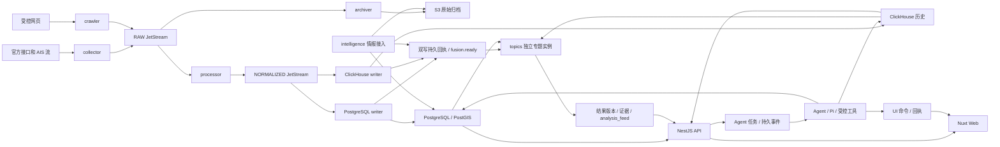

# 海上多元情报分析系统当前架构

本文描述仓库当前实现。通用 Agent SDK 的已确认目标见[SDK 架构](agent-sdk-architecture.md)，后续任务及验收见[开发路线图](agent-sdk-roadmap.md)。SDK 拆包、动态技能配置、远程 MCP 和全站业务操控处于待实施状态；当前交付范围见[实施状态](implementation-status.md)。

## 业务链路与部署边界

系统由 AIS 数据流水线、情报接入、专题计算、Agent 任务和 Web 控制面组成。Bun 管理 TypeScript 工作区，后台运行于 Node.js 24；API 使用 NestJS，Web 使用 Nuxt/Vue 与 MapLibre。

| 路径                             | 当前职责与边界                                                              |
| -------------------------------- | --------------------------------------------------------------------------- |
| `apps/api`                       | 会话认证、角色与 CSRF、HTTP 查询与控制、WebSocket；部分控制器仍直接访问存储 |
| `apps/web`                       | 业务页面、人工地图操作、会话与结果展示、当前页面状态上报及海图命令执行      |
| `apps/collector`、`apps/crawler` | 官方接口/流和受控网页采集，分别承担协议与运行管理                           |
| `apps/processor`                 | 原文解析、标准化、批量位置质量判断、规范化发布与处理统计                    |
| `apps/writer`                    | PostgreSQL 与 ClickHouse 独立消费、持久化、写入回执                         |
| `apps/archiver`                  | 原始报文归档、校验、到期管理和归档恢复                                      |
| `apps/intelligence`              | 公开情报与海况来源接入、原文归档、修订、候选关系和轮询                      |
| `apps/topics`                    | 按专题实例独立订阅、预热、调度、租约、计算与结果提交                        |
| `apps/agent`                     | Pi 驱动任务、技能和工具、模型投影、等待输入/界面回执与续作                  |
| `packages/contracts`             | 运行时 Schema、公开类型、领域和当前 Agent/UI 契约                           |
| `packages/domain`                | 清洗、来源选择、专题算法、意图及输入规则                                    |
| `packages/source-adapters`       | 来源协议、字段和单位解析                                                    |
| `packages/infrastructure`        | 数据库、消息、对象存储，以及目前放在包内的任务与业务编排                    |

采集、清洗、两种写入、归档、情报和专题保留独立进程，分别维护消费进度、失败重试和资源预算。API 与 Agent 已有部分共享入口：AIS 热力图使用 `queryAisHeatmap`，融合数据使用 `queryFusionDataset`，情报检索复用存储查询能力。船舶查询、任务编排和权限规则的进一步统一进入应用层重构。

## 观测、质量与数据所有权

MMSI 使用九位字符串，坐标为 WGS84，时间保存 UTC，航速使用 knots、航向使用 degrees。观测时间 `observedAt` 与接收时间 `receivedAt` 分别保存。缺失观测时间的位置进入隔离；可选哨兵值和非有限值转换为 null 并记录质量；零经纬度保留并标记疑点。超过接收时间五分钟的未来观测进入隔离。

事件 ID 由供应商记录 ID，或来源、类型与原生内容的稳定哈希形成。同源重投幂等，跨来源独立。最新位置按观测时间、来源优先级和稳定事件 ID 选择；默认 MarineTraffic 300、AISStream 200、样例 100。静态信息逐字段维护来源与有效时间。

processor 在规范化发布前调用 `assessPositionQualityBatch`，按相邻位置判断跳跃并复用持久决定，使 PostgreSQL 与 ClickHouse 接收相同质量标记。最新位置、历史、隔离及统计分别保留各自查询口径。

PostgreSQL/PostGIS 保存当前船位、静态来源、业务对象、情报、任务、权限、专题与 Agent 结果。ClickHouse 保存在线历史。S3 保存原始 AIS 和情报原文。版本引用用于重现当次采用的证据，业务规则详见[融合专题](fusion-architecture.md)、[情报检索](intelligence-search.md)和[海图标绘](intelligence-chart.md)。

## 消息、事务与恢复

RAW 使用 file storage 与 InterestPolicy，cleaner 和 archiver 独立确认；NORMALIZED 的 PostgreSQL/ClickHouse writer 独立确认。采集检查点在 RAW 发布确认后推进，消费消息在对应持久化完成后确认。命令流使用 WorkQueuePolicy；collector 的 max pending 为 8，crawler 与 replay 为 1。

两种 writer 持久化后分别写入回执，回执齐备才形成 `fusion_ready_outbox`。专题实例使用各自 durable consumer；同一实例副本共享消费进度，不同实例独立处理。专题 generation 与运行租约隔离旧工作，结果、修订和通知 feed 在同一事务中提交。

超过 256 KiB 的原始响应使用对象引用，响应上限 10 MiB。归档按来源和分钟桶组成 gzip JSONL，以 10,000 条分片；上传对象、提交清单后确认消息。归档保留精确序号区间及空洞，提交后清理 PostgreSQL 临时原文。应用管理到期访问、删除和重试，S3 的 91 天生命周期用于兜底。

采集仓储已提供 fencing 参数，当前 collector/crawler 的部分生产调用仍未传入租约。该调用链风险已列入路线图的优先修复项，底层仓储测试与运行入口修复分别验收。

## 当前 Agent 与界面能力

当前 Agent 使用 Pi 1.1.0 的 agent-core 与 ai 包，连接配置的 DeepSeek 模型。会话、任务、输入修订、步骤、结果和事件由 PostgreSQL 保存；worker 以任务 generation 和租约限制迟到写入。等待用户输入和界面回执通过持久状态释放执行资源。

可信技能目录目前包含 `ais-heatmap`、`vessel-query`、`intelligence-search`、`ui-control` 四份技能；区域研判仍保留兼容执行路径。技能框架已有目录校验、代码授权、预算、模型投影和恢复回执，执行通道统一列入后续重构。

Web 当前支持全站语义状态感知与海图白名单操控，包括面板、页签、图层、已选船位定位、只读浮窗及热图展示/关闭。通用导航、业务编辑保存、删除、审核和系统配置操控处于目标范围。当前接口和恢复语义见[界面协议](agent-ui-protocol.md)。

## 权限与外部数据

HTTP 会话由服务端校验，角色区分 viewer、operator、admin；写请求验证 Origin 与 CSRF。Agent 在任务执行与结果提交阶段检查用户权限、归属、输入修订和运行代次。模型可见内容由宿主按能力投影，精确 AIS、私有原文、密钥与真实业务引用保留本地。

受控网页按注册地址、HTTPS、域名白名单、robots 与授权范围接入；DNS 与重定向检查内部地址，连接固定到已验证地址。来源配置保存授权、secretRef、预算和范围，密钥由运行环境注入。生产覆盖能力、供应商授权和使用限制依实际联调验收。

## 后续演进与验证入口

目标采用四包通用 SDK，加上 AIS 自身的 `packages/application` 共享用例。SDK负责通用执行、协议与浏览器协调；AIS保留领域算法、数据治理、权限政策和业务页面。依赖、存储适配、确认、未知结果与迁移规则以[SDK 架构](agent-sdk-architecture.md)为准。

当前操作入口见[本地开发](development.md)与[部署运行](../infra/OPERATIONS.md)。验证和历史证据分别由[实施状态](implementation-status.md)及报告目录管理；新 SDK 的验收以独立 tarball 消费、vanilla/Vue 订单示例和 AIS 兼容回归共同确认。
