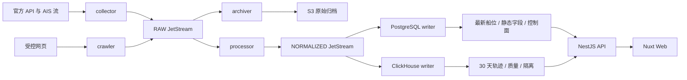

# AIS 平台架构与数据规则

智能体驱动界面的规划见[智能体界面控制协议](agent-ui-protocol.md)，覆盖组件能力、状态查询、命令回执及对话追溯；开发顺序与验收条件见[首期实施计划](superpowers/plans/2026-10-11-agent-ui-control.md)。两份文档定义后续接入方案，当前实现以本文及各模块运行文档为准。

## 数据流与模块边界

`contracts` 定义 Zod 契约与公开类型，`domain` 执行纯清洗和选择规则，`source-adapters` 解释各来源协议和单位。Web 使用公开契约与 OpenAPI 类型；后台基础设施包提供数据库、队列和对象存储。ESLint 管理导入边界，TypeScript/Nuxt 检查类型和自动导入。

## 观测与幂等

MMSI 九位字符串，坐标 WGS84、时间 UTC，航速 knots、航向 degrees。报告时间 observedAt 与接收时间 receivedAt 分别保存。缺失报告时间的位置进入隔离；可选哨兵/非有限值转 null 并标质量；(0,0) 保留并标疑点。

事件 ID 由供应商记录 ID 或来源/类型/原生内容稳定哈希生成，同源重投幂等、跨来源独立。最新位置依次比较报告时间、来源优先级、稳定事件 ID。默认 MarineTraffic 300、AISStream 200、样例 100。静态资料逐字段选择有效新时间，未知或旧时间无法覆盖有效新值。

## 可靠性与存储

RAW 文件存储 InterestPolicy，清洗和归档持久确认；NORMALIZED 的 PostgreSQL/ClickHouse writer 独立确认。检查点在发布确认后推进，消息在持久写入或归档清单提交后确认。Outbox 与来源租约支撑调度恢复。

PostgreSQL 同批归并 MMSI，条件更新最新位置及静态来源。ClickHouse 使用 ReplacingMergeTree 与稳定批次标识，轨迹查询执行查询时去重。轨迹按缺口和日期变更线分段，返回抽稀/截断信息。

原始响应超过 256 KiB 使用对象引用、上限 10 MiB。归档按来源和分钟桶形成 gzip JSONL，10,000 条分片；上传对象、提交清单后 ACK。精确序号区间保留空洞，提交后清除 PG 临时原文。应用管理到期访问和删除重试，91 天生命周期作为兜底。

## 来源准入

受控网页允许注册地址和端口，真实网页使用 HTTPS、白名单、robots 与许可范围。每次 DNS 和重定向检查内部地址，连接固定已验证地址；动态页面使用同样限制。401/403 阻断，429 采用 Retry-After，网络/5xx 限制重试。

来源配置保存启用状态、授权确认、secretRef 环境变量名、速率、预算、轮询范围和分页检查点。密钥保留在进程环境，API 和日志脱敏。覆盖范围和更新能力依据采购与真实联调验收。
