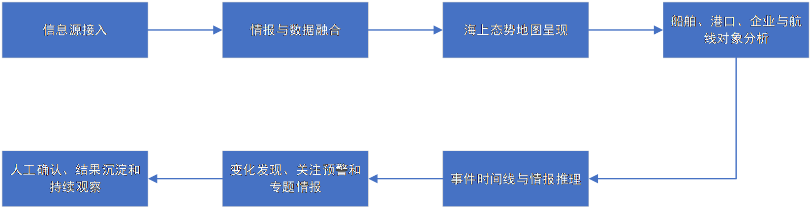

# 产品资料

[产品方案](产品方案.md)描述业务定位、三类态势分析模式、结论溯源与筹划能力；[Word 交付件](海上智能态势与筹划分析产品方案.docx)保存相同正文及正式排版。两份资料在 2026-10-17 整理时按原内容迁入。

[产品补充记录](产品补充记录.md)承接前稿中的细化要求，并列出正式稿对应章节。补充事项供后续需求细化使用，正式稿与 Word 正文继续同步维护。

## 业务流程素材

[PNG](assets/business-loop.png)与 [EMF](assets/business-loop.emf)保留原始素材。图中从信息接入、融合、地图和对象分析延伸到推理、预警与人工复核；它是产品资料中的独立流程图，当前 Word 交付件未嵌入此图。

## 文档维护

生成与导出命令见[文档脚本说明](../../scripts/documents/README.md)。编辑正式方案后，使用同一源稿更新 Word 并检查排版；修订仅落在补充记录时，保留其独立状态。
